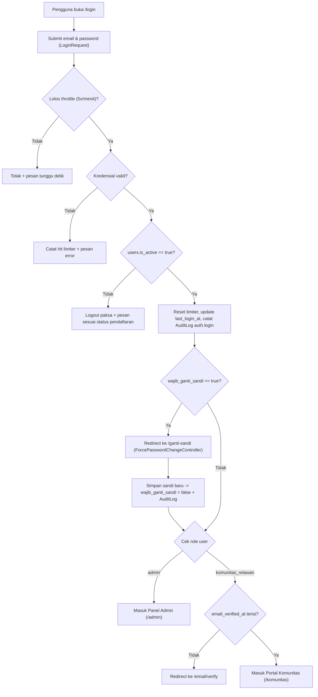
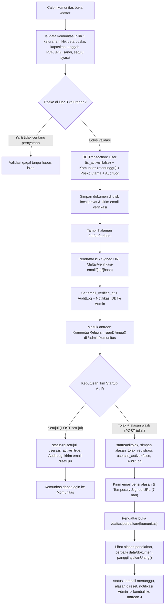
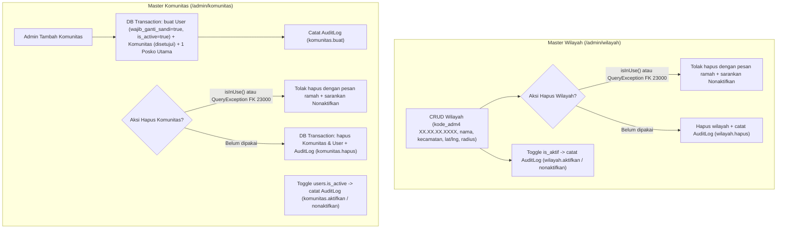
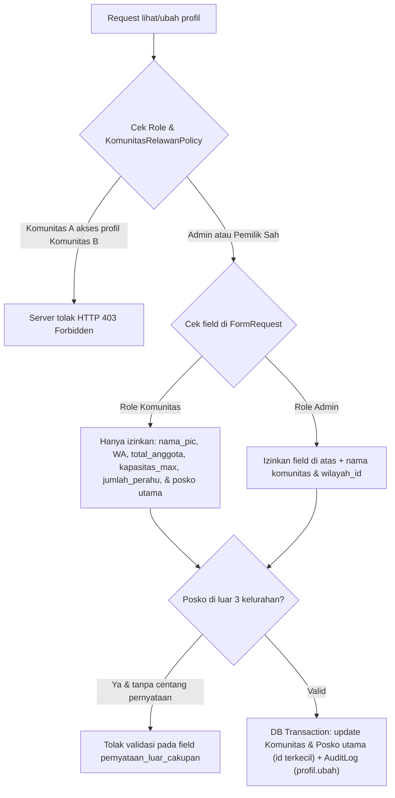
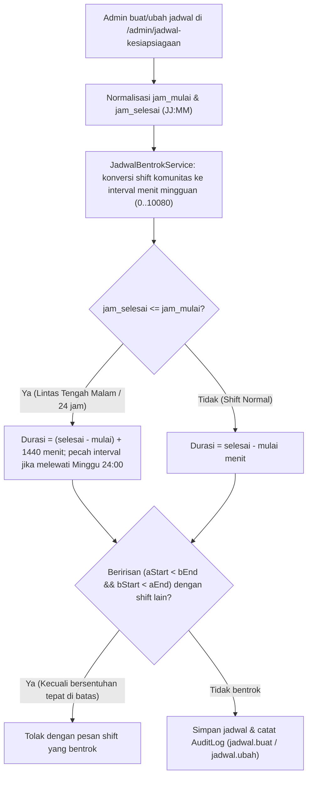

# Handoff Sprint 1: Fondasi Bersama, Fitur 1, & Registrasi Komunitas

Dokumen ini ditujukan untuk seluruh anggota tim pengembang **ALIR** sebagai panduan sinkronisasi setelah melakukan `git pull`, kontrak antarmuka bersama, serta penjelasan lengkap alur dan diagram workflow seluruh fitur yang sudah dikerjakan.

---

## 1. Langkah Wajib Setelah `git pull`

Jalankan perintah berikut pada lingkungan lokal masing-masing:

```powershell
# 1. Perbarui dependensi PHP & JS (termasuk Tailwind CSS 4 & Laravel Dusk)
composer install
npm install
npm run build

# 2. Jalankan migration terbaru (menghapus tabel komunitas_keterampilan)
php artisan migrate
```

### Perubahan Skema & Catatan Penting (*Breaking Changes*)
1. **Penghapusan `komunitas_keterampilan`**:
   - Fitur dan tabel `komunitas_keterampilan` telah dihapus permanen melalui migration baru `database/migrations/2026_11_20_000001_drop_komunitas_keterampilan_table.php` (tanpa mengubah file migration lama agar aman untuk database lokal yang sudah berjalan).
   - Model `KomunitasKeterampilan`, relasi `$komunitas->keterampilan()`, dan pengisian data keterampilan di `KomunitasDefaultSeeder` sudah dihapus.
2. **Email Lokal (`MAIL_MAILER=log`)**:
   - Seluruh email (verifikasi pendaftaran, penolakan + link perbaikan, persetujuan, dan reset kata sandi) akan tercatat di `storage/logs/laravel.log` selama mode pengembangan lokal.
3. **Database Pengujian**:
   - `phpunit.xml` dikonfigurasi ke database MySQL terpisah **`alir_test`** (karena ekstensi `pdo_sqlite` tidak aktif di beberapa konfigurasi PHP Laragon). Buat database `alir_test` di MySQL lokal sebelum menjalankan `php artisan test`.
   - Untuk Laravel Dusk, buat `.env.dusk.local` yang mengarah ke database terpisah **`alir_dusk`** (`.env.dusk.*` sudah masuk `.gitignore`).

---

## 2. Kontrak Antarmuka Bersama (Untuk Fitur 2, 3, 4, & 5)

### 2.1. Middleware & Autentikasi (`bootstrap/app.php`)
Gunakan alias middleware berikut pada route yang Anda buat:

| Alias Middleware | Fungsi | Contoh Pemakaian |
| :--- | :--- | :--- |
| `role:admin` | Memastikan user login, `is_active === true`, dan `User::isAdmin()`. Mengembalikan **403** bila role salah. | `->middleware(['auth', 'password.changed', 'role:admin'])` |
| `role:komunitas_relawan` | Memastikan user login, `is_active === true`, dan `User::isKomunitas()`. Mengembalikan **403** bila role salah. | `->middleware(['auth', 'verified', 'password.changed', 'role:komunitas_relawan'])` |
| `password.changed` | Mengarahkan user dengan `wajib_ganti_sandi = true` ke `/ganti-sandi` sebelum bisa membuka halaman panel. | Ditaruh sebelum `role:...` pada grup panel. |

### 2.2. Prefix Route & Layout Blade
- **Panel Admin (`Tim Startup ALIR`)**:
  - Prefix URL: `/admin/...` | Nama route: `admin.*`
  - Layout: `@extends('layouts.admin')` (`resources/views/layouts/admin.blade.php`)
- **Portal Komunitas Relawan**:
  - Prefix URL: `/komunitas/...` | Nama route: `komunitas.*`
  - Layout: `@extends('layouts.komunitas')` (`resources/views/layouts/komunitas.blade.php`)
- **Halaman Tamu / Auth**:
  - Layout: `@extends('layouts.guest')` (split-screen login/reset) dan `@extends('layouts.register')` (split-screen form + peta Leaflet).
- **Komponen Flash Message & Validasi**:
  - Sudah terpasang otomatis di dalam `layouts/admin` dan `layouts/komunitas` via `<x-flash-message />` (`session('success')`, `session('warning')`, `session('error')`, `session('status')`, dan `$errors`).
- **Cara Menambah Menu Sidebar**:
  - Edit `resources/views/layouts/admin.blade.php` atau `resources/views/layouts/komunitas.blade.php`.
  - Aset CSS/JS (`resources/css/tokens.css`, `base.css`, `animations.css`, `panel.css`, Tailwind CSS 4, dan `resources/js/alir-ui.js`) sudah dibundle melalui `@vite(['resources/css/app.css', 'resources/js/app.js'])`.

### 2.3. Scope & Method Model yang Wajib Dipakai Modul Lain

| Anggota / Fitur | Model & Kontrak Method | Kegunaan |
| :--- | :--- | :--- |
| **Azaila (Fitur 2)** | `Wilayah::aktif()` | Hanya memakai kelurahan dengan `is_aktif = true`. |
| **Azaila (Fitur 2)** | `Wilayah::temukanDari($lat, $lng)` / `$w->cekKoordinat($lat, $lng)` | Validasi koordinat titik laporan (poligon GeoJSON jika ada, fallback ke `radius_cakupan_m`). |
| **Monica (Fitur 3)** | `auth()->user()->komunitasRelawan` | Mengambil profil komunitas milik user komunitas yang sedang login. |
| **Siska (Fitur 5)** | `KomunitasRelawan::aktif()` | Komunitas dengan `status_pendaftaran = 'disetujui'` **dan** `users.is_active = true`. |
| **Siska (Fitur 5)** | `KomunitasRelawan::siagaPada(?CarbonInterface $waktu = null)` | Komunitas `aktif()` yang memiliki jadwal `siagaPada($waktu)` (termasuk `siaga_terbatas`, tidak termasuk `tidak_tersedia`). |
| **Siska (Fitur 5)** | `JadwalKesiapsiagaan::siagaPada(?CarbonInterface $waktu = null)` | Mengambil shift berjalan pada `$waktu`, termasuk shift lintas tengah malam (`jam_selesai <= jam_mulai`). |
| **Siska (Fitur 5)** | `$komunitas->poskoUtama()` & `$posko->hitungJarak($lat, $lng)` | Mengambil posko utama (`id` terkecil) dan jarak Haversine dalam kilometer. |
| **Semua Modul** | `AuditLog::catat(string $aksi, ?Model $subjek, ?string $deskripsi, ?User $user)` | Mencatat jejak audit (*who, when, what, IP*) secara seragam. |

---

## 3. Alur Kerja & Diagram Workflow per Fitur

### 3.1. Fondasi Autentikasi, Role Middleware, Wajib Ganti Sandi, & Reset Sandi

Sistem autentikasi menangani dua role login (`admin` dan `komunitas_relawan`), pembatasan percobaan login (5 kali/menit per email+IP), pemblokiran akun nonaktif/belum disetujui, kewajiban ganti sandi awal untuk akun buatan Admin/Seeder, serta lupa & atur ulang kata sandi via email.



**Catatan Lupa & Reset Sandi**:
- `/lupa-sandi` (`password.request`) mengirim token reset ke email via Laravel Password Broker.
- `/reset-sandi/{token}` (`password.reset`) memperbarui kata sandi, mereset `wajib_ganti_sandi = false`, dan mencatat `AuditLog::catat('auth.reset_sandi', ...)`.

---

### 3.2. Registrasi Mandiri Komunitas, Verifikasi Email, & Peninjauan Admin (FR-02)

Calon komunitas mendaftar tanpa login melalui `/daftar`. Akun `users` langsung dibuat dalam keadaan **nonaktif (`is_active = false`)** sehingga belum dapat login hingga email terverifikasi dan Admin menyetujuinya. Dokumen pendukung disimpan di storage privat `local` (`storage/app/private/dokumen-komunitas/`).



**Proteksi Keamanan Alur Registrasi**:
- Dokumen pendukung tidak disimpan di `public/storage`; Admin melihat/mengunduh berkas melalui route `GET /admin/komunitas/{komunitas}/dokumen` yang dilindungi middleware `role:admin`.
- Route perbaikan `/daftar/perbaikan/{komunitas}` dilindungi middleware `signed` (berlaku 7 hari) dan otomatis tidak tersedia apabila status bukan lagi `ditolak`.
- Jika pendaftar mencoba login sebelum waktunya, `LoginRequest` menampilkan pesan spesifik sesuai tahapnya (*belum verifikasi email*, *menunggu persetujuan Admin*, *ditolak*, atau *dinonaktifkan*).

---

### 3.3. PBI-1.1: Manajemen Master Data Wilayah & Komunitas

Hanya dapat diakses oleh **Admin** (`/admin/wilayah` dan `/admin/komunitas`).



**Kriteria `isInUse()` & Penanganan FK**:
- `Wilayah::isInUse()`: bernilai `true` bila memiliki `laporanBanjir`. Jika masih terikat `komunitas_relawan` (`restrictOnDelete`), `QueryException` kode `23000` ditangkap di `WilayahService` dan diubah menjadi pesan ramah.
- `KomunitasRelawan::isInUse()`: bernilai `true` bila memiliki `penugasan`, `inventaris`, atau `konfirmasiLapangan`. Pelanggaran FK lain (`permintaan_logistik`, `wishlist_donasi`, `dokumentasi`, dll.) juga ditangkap dengan aman.

---

### 3.4. PBI-1.2: Pengelolaan Profil Komunitas & Posko Utama

Form profil dipakai bersama oleh **Admin** (`/admin/komunitas/{komunitas}/profil`) dan **Komunitas** (`/komunitas/profil/{komunitas?}`) dengan pembatasan ketat di server melalui `KomunitasRelawanPolicy` dan `UpdateProfilKomunitasRequest`.



**Field yang Diblokir dari Mass Assignment Komunitas**: `user_id`, `status_pendaftaran`, `diverifikasi_pada`, `alasan_tolak_registrasi`, `dokumen_pendukung_path`, `menyetujui_syarat_pada`, `izin_tampil_publik`, `users.role`, `users.is_active`, dan `users.email`.

---

### 3.5. PBI-1.3: Manajemen Jadwal Kesiapsiagaan

Admin memiliki akses penuh CRUD semua jadwal komunitas (`/admin/jadwal-kesiapsiagaan`), sedangkan Komunitas hanya memiliki akses **baca saja** untuk jadwal miliknya (`/komunitas/jadwal-kesiapsiagaan`).



**Aturan Pembacaan Jadwal untuk Fitur 5 (`siagaPada`)**:
- `siaga_terbatas` tetap dihitung **tersedia** oleh `JadwalKesiapsiagaan::siagaPada()` (hanya `tidak_tersedia` yang dikecualikan).
- `KomunitasRelawan::siagaPada($waktu)` hanya mengembalikan komunitas yang `status_pendaftaran = 'disetujui'` **dan** `users.is_active = true`.

---

## 4. Daftar Route Aktif & Akun Pengujian

### Route Utama yang Tersedia
- **Publik / Auth**:
  - `GET /login` (`login`), `POST /logout` (`logout`)
  - `GET /daftar` (`register`), `POST /daftar` (`register.store`), `GET /daftar/terkirim` (`register.sent`)
  - `GET /daftar/verifikasi-email/{id}/{hash}` (`register.verify-email`, signed)
  - `GET /daftar/perbaikan/{komunitas}` (`register.perbaikan.edit`, signed), `PUT /daftar/perbaikan/{komunitas}` (`register.perbaikan.update`, signed)
  - `GET /lupa-sandi` (`password.request`), `GET /reset-sandi/{token}` (`password.reset`)
  - `GET /ganti-sandi` (`password.force.edit`)
- **Admin (`prefix: /admin`, `name: admin.*`)**:
  - `/admin` (`admin.dashboard`)
  - `/admin/wilayah` (`admin.wilayah.*` + `admin.wilayah.toggle-status`)
  - `/admin/komunitas` (`admin.komunitas.*` + `admin.komunitas.toggle-status`, `dokumen`, `setujui`, `tolak`)
  - `/admin/komunitas/{komunitas}/profil` (`admin.profil.edit`, `admin.profil.update`)
  - `/admin/jadwal-kesiapsiagaan` (`admin.jadwal.*`)
- **Komunitas (`prefix: /komunitas`, `name: komunitas.*`)**:
  - `/komunitas` (`komunitas.dashboard`)
  - `/komunitas/profil/{komunitas?}` (`komunitas.profil.edit`, `komunitas.profil.update`)
  - `/komunitas/jadwal-kesiapsiagaan` (`komunitas.jadwal.index`)

### Akun Default dari Seeder (`php artisan db:seed`)
- **Admin**: `admin@alir.test` / `password`
- **Komunitas Pilot** *(wajib ganti sandi saat login pertama)*:
  - `komunitas.tirto@alir.test` / `password`
  - `komunitas.pasirkratonkramat@alir.test` / `password`
  - `komunitas.degayu@alir.test` / `password`

---

## 5. Cara Menjalankan Automated Tests

```powershell
# 1. Cek format kode Laravel Pint
php vendor/bin/pint --test

# 2. Jalankan seluruh Unit & Feature tests (menggunakan DB alir_test)
php artisan test

# 3. Jalankan Laravel Dusk Browser Tests (butuh server lokal di port 8000 & DB alir_dusk)
# Terminal 1:
php artisan serve --env=dusk.local --host=127.0.0.1 --port=8000
# Terminal 2:
php artisan dusk
```
